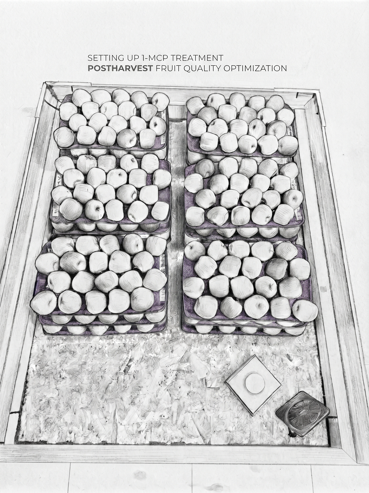

# Research Overview

My research bridges whole-canopy tree fruit physiology, post-harvest quality preservation, and molecular biology. I combine field horticultural trials, biochemical assays, and transcriptomic profiling to solve critical challenges in commercial fruit production and post-harvest storage.

---

## 1. Post-Harvest Physiology & Cold Storage Dynamics (UMD)
*Postdoctoral Research | Department of Plant Science & Landscape Architecture, University of Maryland, College Park*

  
  <!-- Left Column: Text (Determines the row height) -->
  

    
Post-harvest storage strategies must balance firmness retention, metabolic stability, and physiological disorder mitigation. My current research focuses on:

    <ul style="margin-bottom: 0;">
      <li><strong>Storage Temperature Regimes:</strong> Evaluating physiological responses and fruit quality dynamics under standard commercial cold storage regimes (0°C vs. 3°C regular air).</li>
      <li><strong>Ethylene Perception Inhibition (1-MCP):</strong> Assessing the efficacy of 1-methylcyclopropene treatments in custom sealed enclosures to suppress ethylene synthesis and maintain hormonal balance in commercial cultivars such as 'Ambrosia' and 'Fuji'.</li>
      <li><strong>Post-Storage Shelf-Life Tracking:</strong> Profiling internal ethylene concentration (IEC), soluble solids content (SSC), titratable acidity (TA), hormonal and genomic profiles during extended room temperature (20°C) shelf-life evaluations following cold storage.</li>
    </ul>
  

  <!-- Right Column: Image (Matches the exact height of the text column) -->
  

    
  

---

## 2. Decoupling Fruit Drop from Ripening & Color Enhancement (Virginia Tech)
*Doctoral Dissertation Research | Alson H. Smith Jr. AREC, Virginia Tech*

A major commercial challenge in apple production (*Malus × domestica*) is the trade-off between allowing fruit to hang long enough to develop red color and preventing pre-harvest fruit drop:
* **Synergistic Plant Growth Regulator (PGR) Strategies:** Investigated combinations of aminoethoxyvinylglycine (AVG, an ethylene biosynthesis inhibitor) and 1-aminocyclopropane-1-carboxylic acid (ACC, an ethylene precursor) or naphthaleneacetic acid (NAA) to decouple fruit abscission from ripening and enhance peel red coloration in cultivars like 'Honeycrisp'.
* **Abscission Zone (AZ) Dynamics:** Characterized cell separation events, reactive oxygen species (ROS) accumulation (superoxide and hydrogen peroxide), and cellular degradation in the pedicel abscission zone.
* **Molecular Profiling & Gene Expression:** Conducted RNA-Seq, DESeq2 differential expression, and qRT-PCR validation on canonical ethylene-auxin pathway components and stress-responsive regulatory genes to elucidate hormonal crosstalk with ROS homeostasis governing fruit retention.

---

## 3. Climate Resilience & Spring Frost Risk Mitigation (Virginia Tech)
*Collaborative Research | Alson H. Smith Jr. AREC, Virginia Tech*

Unpredictable late-spring frost events pose a severe economic threat to temperate tree fruit production by damaging sensitive floral tissues during bloom:
- **Spring Freeze Protection Strategies:** Collaborated on field trials evaluating targeted frost-mitigation treatments to protect apple and peach blossoms against acute spring freeze injury.
- **Flower Bud Cold Hardiness & Survival:** Assessed floral bud mortality, fruit set, and yield stability following late-spring cold events to identify practical risk-reduction protocols for commercial orchardists.

---

## 4. Plant Pathology, Citrus Greening (HLB), & Applied Crop Research (BARI)
*Scientific Officer & Research Assistant | Bangladesh Agricultural Research Institute*

Prior to my doctoral work, I led and collaborated on multidisciplinary laboratory and applied field research addressing key production constraints in horticultural and staple crops:
- **Multidisciplinary Applied Research & Variety Trials:** Collaborated on regional adaptability, agronomic performance, and disease-resistance evaluations across diverse tuber crop (potato, sweet potato), fruit, and vegetable germplasm to support cultivar release and grower adoption.
- **Citrus Greening (Huanglongbing - HLB):** Conducted molecular detection and confirmation of *Candidatus* Liberibacter asiaticus in Bangladesh across sweet orange and mandarin orchards; developed symptom-based visual diagnostic toolkits for growers.
- **Viral Pathogens:** Documented the first report and distribution of Citrus Tristeza Virus (CTV) in Bangladesh using serological and molecular assays.
- **Integrated Disease & Pest Management (IDM/IPM):** Formulated field management packages for vegetable and root crops, including sweet potato weevil (*Cylas formicarius*), soil-borne pathogens (*Athelia rolfsii*), and bacterial/fungal complexes in Solanaceous crops.

---

## Methodological Expertise

| Area | Techniques & Tools |
| :--- | :--- |
| **Physiology & Fruit Quality** | Internal Ethylene Concentration (Gas Chromatography), DA-meter index, acoustic firmness, colorimetry, starch-iodine index, titratable acidity |
| **Biochemistry** | Spectrophotometric quantification of pigments, non-structural carbohydrates and ROS |
| **Molecular Biology** | CTAB RNA/DNA extraction from recalcitrant fruit tissues, cDNA synthesis, RT-qPCR, primer design, basic tissue culture |
| **Bioinformatics & Analytics** | RStudio statistical modeling and visualization, RNA-Seq analysis, KEGG pathway enrichment, DAVID functional annotation  |
